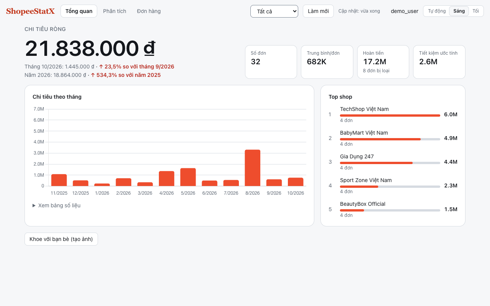
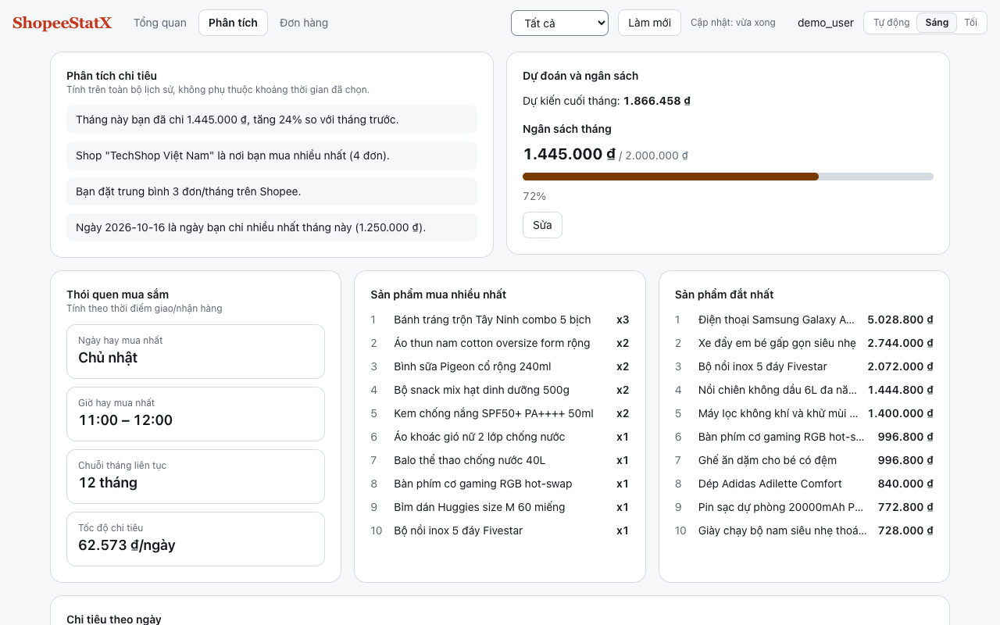
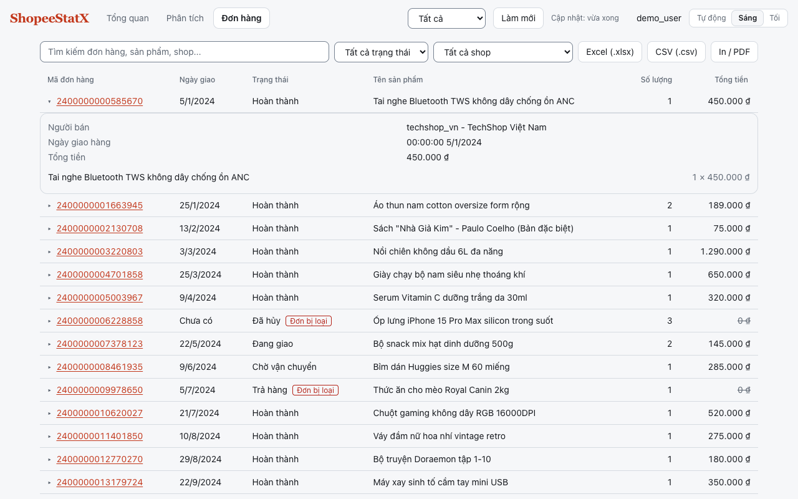
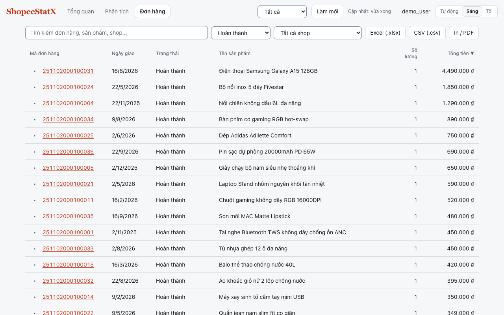
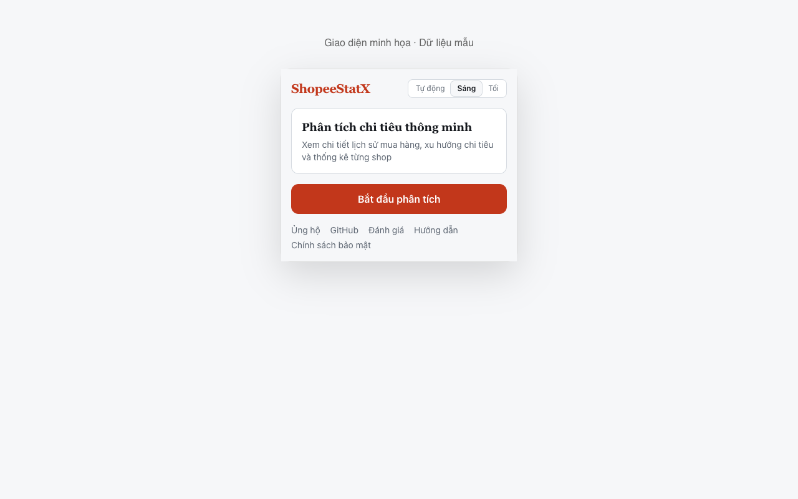

# ShopeeStatX - Thống Kê Chi Tiêu Shopee

<div align="center">


[](#)
[](docs/guide/README-en.md)

---

[](https://github.com/ninhhaidang/shopeestatx/stargazers)
[](https://github.com/ninhhaidang/shopeestatx/releases)
[](LICENSE)

</div>

> **Version 3.1.0** - React + Tailwind + Vite, Light/Dark, multi-domain

> Chrome Extension giúp theo dõi và phân tích chi tiêu trên Shopee một cách chi tiết và trực quan.

## 📸 Screenshots











## Giới thiệu

Shopee không cung cấp bất kỳ công cụ nào để người dùng biết mình đã tiêu bao nhiêu. ShopeeStatX giải quyết vấn đề đó — một extension Chrome tự động lấy toàn bộ lịch sử đơn hàng, phân tích và hiển thị trực quan bằng biểu đồ và bảng dữ liệu. Không cần server, không cần tài khoản riêng, dữ liệu không rời khỏi máy bạn.

## Tính năng chính

### 📊 Tổng quan
- **Chi tiêu ròng** (không tính đơn hủy/trả hàng), so với tháng trước
- Số đơn, trung bình/đơn, hoàn tiền, tiết kiệm ước tính
- Biểu đồ chi tiêu theo tháng (kèm bảng số liệu), top shop
- Ảnh chia sẻ chỉ chứa số liệu tổng hợp

### 🗓️ Khoảng thời gian toàn cục
- Một bộ chọn khoảng ngày áp dụng cho Tổng quan, Phân tích và Đơn hàng

### 📋 Đơn hàng
- Tìm kiếm theo sản phẩm, shop, mã đơn; lọc theo trạng thái và shop; sắp xếp; phân trang
- Chi tiết đơn; trên khổ hẹp bảng chuyển thành danh sách thẻ
- Xuất Excel (.xlsx), CSV, In / PDF theo đúng bộ lọc đang áp dụng

### 🔎 Phân tích
- Biểu đồ nhiệt số đơn theo ngày, thói quen mua sắm, sản phẩm mua nhiều, nhận xét tự động
- Dự đoán chi tiêu cuối tháng và ngân sách có cảnh báo

### 🎨 Giao diện
- Một UI thích ứng cho tab, side panel và popup; Light / Dark / Tự động

## Cách hoạt động

### Mô hình xác thực
ShopeeStatX sử dụng phiên đăng nhập sẵn có của trình duyệt để truy cập dữ liệu Shopee. Người dùng chỉ cần đăng nhập Shopee như bình thường — extension tự động sử dụng session đó để gọi API. Không cần tạo tài khoản riêng, không lưu mật khẩu, không gửi dữ liệu ra ngoài.

Đây là mô hình xác thực chuẩn công nghiệp cho các extension chạy trên website cụ thể (tương tự Grammarly, Honey, Return YouTube Dislike).

- Kiểm tra domain: Chỉ hoạt động khi đang ở Shopee (shopee.vn, shopee.co.id, shopee.co.th, shopee.ph, shopee.com.my, shopee.sg, shopee.tw)
- Chưa đăng nhập: Hiển thị cảnh báo, vô hiệu hóa nút bắt đầu
- Đã đăng nhập: Gọi API bằng session trình duyệt qua MAIN world injection

### Luồng dữ liệu
```
Đăng nhập Shopee → Click icon extension → Popup kiểm tra domain
  → "Bắt đầu phân tích" → Mở dashboard (tab mới)
    → Loading spinner + cập nhật real-time số đơn đang lấy
      → Inject content.js (MAIN world) + bridge.js (ISOLATED world)
        → Fetch API Shopee (dùng session trình duyệt, có cookie)
        → postMessage → bridge → chrome.runtime → dashboard
          → Cache vào chrome.storage.local
          → Render: Tổng quan / Đơn hàng / Phân tích (React)
            → Tương tác: Khoảng ngày / Lọc / Tìm kiếm / Sắp xếp / Ngân sách / Xuất dữ liệu / Ảnh chia sẻ
```

### Kiến trúc Dual-World
Chrome Extension mặc định chạy trong ISOLATED world — không thể truy cập cookie của trang web. ShopeeStatX giải quyết bằng Dual-World Pattern:

- `content.js` chạy trong MAIN world → truy cập fetch() và cookie như trang web bình thường (IIFE, không bundle)
- `bridge.ts` chạy trong ISOLATED world → relay message về extension
- Kết quả: Bypass CORS hợp lệ, không cần proxy server, không cần API key riêng

```
┌──────────────┐    ┌──────────────┐    ┌──────────────┐
│  Popup       │───▶│ dashboard    │───▶│ chrome-host  │
│ (Trigger)    │    │ (React UI)   │    │ (Orchestrator)│
└──────────────┘    └──────┬───────┘    └──────┬───────┘
                           │                    │
                    inject │              listen│
                           ▼                    │
               ┌───────────────────┐            │
               │   Shopee Tab      │            │
               │                   │            │
               │ ┌───────────────┐ │  message   │
               │ │  content.js   │─┼────────────┘
               │ │  (MAIN world) │ │  via bridge.ts
               │ │  fetch API    │ │  (ISOLATED world)
               │ └───────────────┘ │
               └───────────────────┘
```

## ⚙️ Cài đặt

### Cài từ Chrome Web Store (Khuyến nghị)
[Cài ShopeeStatX trên Chrome Web Store](https://chromewebstore.google.com/detail/shopeestatx/hhcfonmapcabjmaghpapehegbmhdceim).

### Cài thủ công (Developer mode)
1. Tải file ZIP từ [Releases](https://github.com/ninhhaidang/shopeestatx/releases) và giải nén, hoặc clone repo:
   ```bash
   git clone https://github.com/ninhhaidang/shopeestatx.git
   ```
2. Mở Chrome, vào `chrome://extensions/`
3. Bật **Chế độ nhà phát triển** (Developer mode)
4. Click **Tải chưa giải nén** và chọn thư mục `ShopeeStatX`

## 📖 Hướng dẫn sử dụng

Xem hướng dẫn chi tiết tại [Hướng dẫn sử dụng](docs/guide/Huong_dan.md)

**Tóm tắt:**
1. Đăng nhập tài khoản [Shopee](https://shopee.vn)
2. Bật tiện ích ShopeeStatX trên thanh công cụ Chrome
3. Click **Bắt đầu phân tích**
4. Sử dụng bộ lọc và biểu đồ để phân tích chi tiêu

## 🛠️ Công nghệ sử dụng

| Công nghệ | Vai trò | Lý do lựa chọn |
|-----------|---------|----------------|
| Chrome Extension MV3 | Runtime | Standard mới nhất, Service Worker model |
| React 19 + Radix | UI | Một UI thích ứng cho tab, side panel và popup ([ADR-0001](docs/adr/0001-react-tailwind-ui.md), [ADR-0002](docs/adr/0002-one-adaptive-ui-for-all-hosts.md)) |
| Tailwind CSS v4 | Styling | Design tokens dạng CSS variables, Light/Dark/Auto |
| TypeScript | Ngôn ngữ | Strict mode, type safety, zero `any` |
| Vite | Build tool | Fast builds, multi-entry cho extension |
| Vitest + Testing Library | Testing | jsdom, test ở component gốc, coverage |
| Chart.js | Visualization | Bọc thành component `BarChart` |
| ExcelJS | Export | Tạo file Excel (.xlsx) |
| chrome.storage.local | Cache | Lưu dữ liệu offline, không cần server |
| Shopee API v4 | Data source | `v4/order/get_all_order_and_checkout_list` |

## 📁 Cấu trúc dự án

```
ShopeeStatX/
├── src/
│   ├── manifest.json             # Cấu hình extension (Manifest V3)
│   ├── background.ts             # Service worker
│   ├── config.ts                 # Hardcoded values (domains, storage keys)
│   ├── content/content.js        # MAIN world — gọi Shopee API (IIFE, không bundle)
│   ├── bridge/bridge.ts          # ISOLATED world — relay message
│   ├── dashboard-app/            # Dashboard React (tab Tổng quan / Đơn hàng / Phân tích)
│   ├── popup/                    # Popup React
│   ├── welcome/                  # Onboarding React
│   ├── privacy/                  # Chính sách riêng tư React
│   ├── ui/                       # Component dùng chung, design tokens, theme
│   ├── dashboard/                # Logic miền thuần (stats, insights, budget, export, ...)
│   ├── i18n/                     # Đa ngôn ngữ (hiện tại: Tiếng Việt)
│   └── types/index.ts            # TypeScript interfaces
├── docs/                         # ADR, tài liệu Shopee API, hướng dẫn
├── tests/                        # Vitest test files
├── dist/                         # Vite build output (bị ignore)
├── vite.config.ts
└── vitest.config.ts
```

Phần giao diện được dựng lại theo [ADR-0001](docs/adr/0001-react-tailwind-ui.md) (React + Tailwind) và [ADR-0002](docs/adr/0002-one-adaptive-ui-for-all-hosts.md) (một UI thích ứng theo container). Bản mẫu phong cách trực quan (style reference) nằm ở nhánh `prototype/overview`. Ràng buộc về request tới Shopee: [docs/shopee-order-api.md](docs/shopee-order-api.md).

## 🧪 Phát triển

### Yêu cầu
- Node.js 24+
- npm hoặc yarn

### Scripts

```bash
npm install              # Cài đặt dependencies
npm run dev              # Vite dev server (localhost:5173) với mock data
npm run build            # Typecheck + build production → dist/
npm run check:injected   # Kiểm tra bridge.js/content.js parse được như classic script
npm run typecheck        # Kiểm tra TypeScript
npm test                 # Chạy tests (Vitest)
npm run test:watch       # Tests trong watch mode
npm run test:coverage    # Tests với coverage report
npm run verify           # CI: typecheck, knip (unused files/exports/deps), tests, build, injected scripts
```

### Demo Mode
Mở trang dashboard ngoài extension (`npm run dev`, `npm run preview`) thì dashboard tự dùng mock data thay vì gọi Shopee API, nên phát triển UI không cần cài extension. Trong build dev nạp vào Chrome, thêm `?mock=1` vào URL dashboard để xem mock data; build production bỏ qua tham số này.

### Phiên bản Chrome tối thiểu (116)
`minimum_chrome_version` là 116 vì giao diện dùng: container query (Chrome 105), `color-mix()` (Chrome 111) và `chrome.sidePanel.open()` cho tuỳ chọn mở bằng side panel sắp tới (Chrome 116). Xem thêm `docs/adr/0002-one-adaptive-ui-for-all-hosts.md`.

## ⚠️ Lưu ý

- Extension chỉ hoạt động khi đã đăng nhập Shopee
- Hỗ trợ đa quốc gia: shopee.vn, shopee.co.id, shopee.co.th, shopee.ph, shopee.com.my, shopee.sg, shopee.tw
- Dữ liệu lấy trực tiếp từ API Shopee, không qua server trung gian
- Ngày giao hàng: Thời điểm giao/nhận hàng thành công
- Đơn đã hủy và trả hàng: Không tính vào tổng chi tiêu
- Dữ liệu chỉ tồn tại trong session cục bộ, không gửi đi đâu
- Extension này không liên quan đến Shopee chính thức

## License

[MIT License](LICENSE)

## 👨‍💻 Tác giả

<div align="center">

**Phát triển bởi [Ninh Hải Đăng](https://github.com/ninhhaidang)**

[](https://ninhhaidang.dev)
[](https://github.com/ninhhaidang)
[](https://www.buymeacoffee.com/ninhhaidang)

</div>
