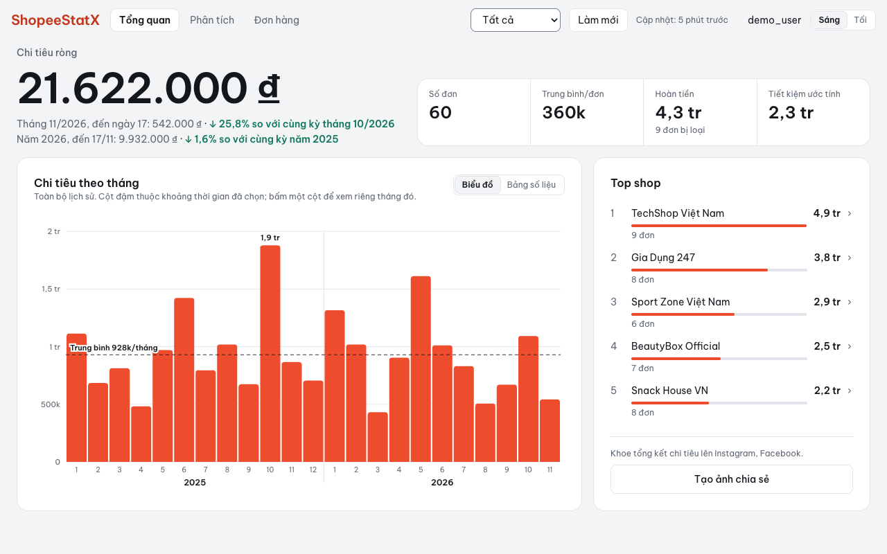
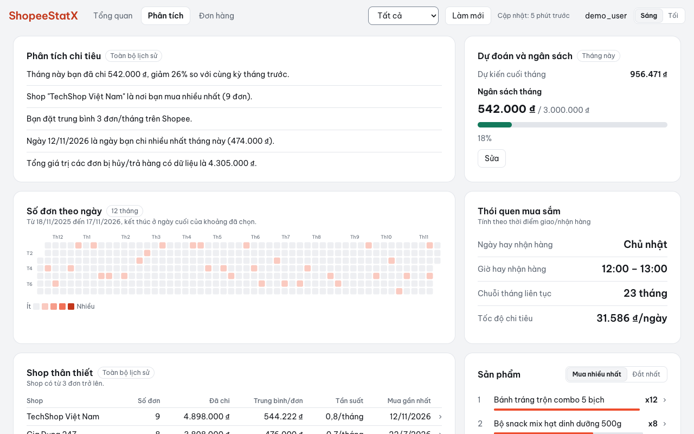
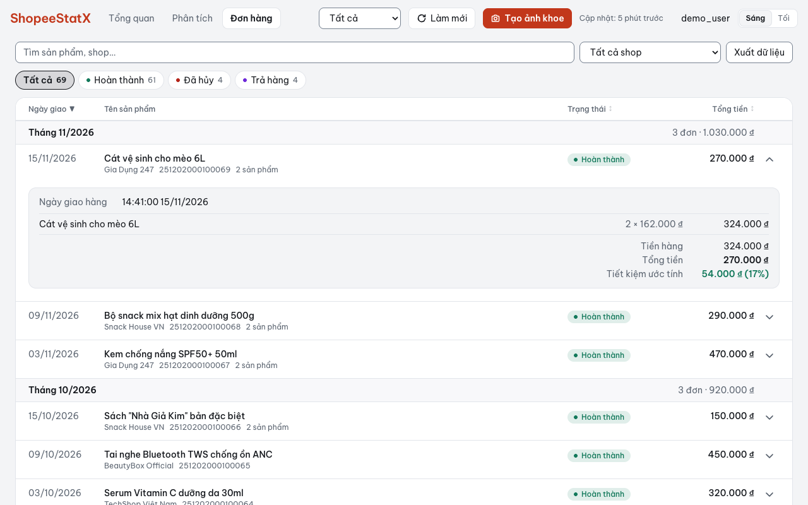
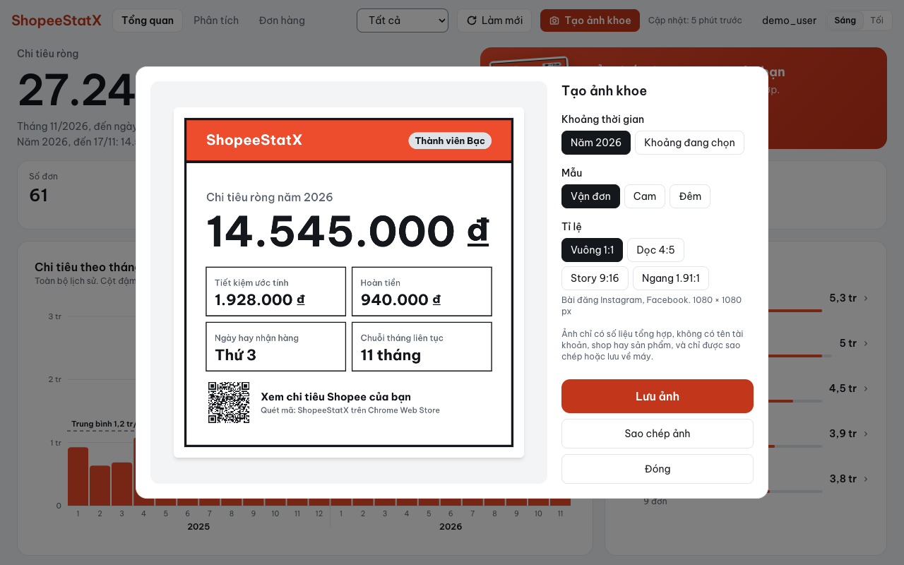
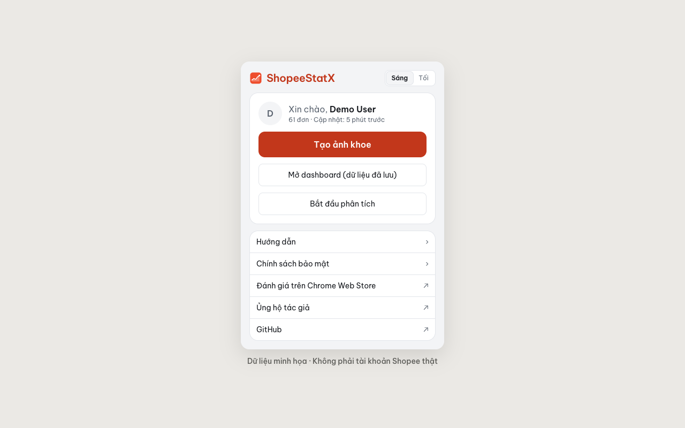

<div align="center">


# ShopeeStatX

**Hiểu rõ bạn đã chi bao nhiêu trên Shopee.**

Tiện ích Chrome tổng hợp lịch sử mua hàng **Shopee Việt Nam** thành thống kê chi tiêu, phân tích thói quen và ngân sách tháng — xử lý hoàn toàn trong trình duyệt.

[](https://chromewebstore.google.com/detail/shopeestatx/hhcfonmapcabjmaghpapehegbmhdceim)
[](https://github.com/ninhhaidang/shopeestatx/releases/latest)
[](https://github.com/ninhhaidang/shopeestatx/actions/workflows/ci.yml)
[](LICENSE)

[Cài đặt](https://chromewebstore.google.com/detail/shopeestatx/hhcfonmapcabjmaghpapehegbmhdceim) · [Hướng dẫn](docs/guide/Huong_dan.md) · [English](docs/guide/README-en.md)

</div>

## Ảnh chụp màn hình

| Tổng quan | Phân tích |
| --- | --- |
|  |  |
| **Đơn hàng** | **Ảnh chia sẻ** |
|  |  |
| **Popup** | |
|  | |

<sub>Ảnh dùng dữ liệu minh họa, không phải lịch sử mua hàng thật.</sub>

## Tính năng

- **Tổng quan** — chi tiêu ròng, số đơn, giá trị trung bình; so sánh cùng kỳ tháng/năm; hoàn tiền và tiết kiệm ước tính; biểu đồ theo tháng và shop chi nhiều nhất.
- **Phân tích** — nhận xét tự động, ngân sách tháng với ngưỡng cảnh báo và dự đoán cuối tháng, biểu đồ nhiệt theo ngày, shop và sản phẩm mua lại.
- **Đơn hàng** — tìm theo mã đơn, sản phẩm, shop; lọc theo thời gian, trạng thái; xem chi tiết từng đơn.
- **Xuất dữ liệu** — Excel, CSV, In/PDF theo toàn bộ kết quả đang lọc; ảnh chia sẻ không chứa thông tin tài khoản.
- Giao diện Sáng/Tối, thích ứng khổ hẹp.

Đơn hủy, trả hàng và chờ thanh toán không tính vào chi tiêu.

## Bắt đầu

1. [Cài ShopeeStatX](https://chromewebstore.google.com/detail/shopeestatx/hhcfonmapcabjmaghpapehegbmhdceim) (hoặc tải gói ZIP ở [Releases](https://github.com/ninhhaidang/shopeestatx/releases/latest) và **Load unpacked**).
2. Đăng nhập [shopee.vn](https://shopee.vn).
3. Bấm biểu tượng tiện ích → **Bắt đầu phân tích**.

Chi tiết xem [hướng dẫn sử dụng](docs/guide/Huong_dan.md).

## Quyền riêng tư

- Dùng phiên đăng nhập Shopee sẵn có — không cần nhập mật khẩu, không có tài khoản ShopeeStatX.
- Dữ liệu chỉ lưu trong `chrome.storage.local`; không máy chủ, không theo dõi, không telemetry.
- Gỡ tiện ích là xóa toàn bộ dữ liệu đã lưu.

Chi tiết trong **Chính sách bảo mật** ở popup của tiện ích.

## Giới hạn

- Chỉ hỗ trợ `https://shopee.vn`, Chrome 116+.
- Phụ thuộc dữ liệu Shopee trả về; thay đổi phía Shopee có thể làm việc lấy đơn thất bại.
- Bộ lọc thời gian dùng ngày giao/nhận hàng, không phải ngày đặt.
- Tiết kiệm và dự đoán cuối tháng là số ước tính.
- Khi mở CSV bằng Excel, đặt cột mã đơn là Text để không bị làm tròn (XLSX không gặp vấn đề này).

## Phát triển

Yêu cầu Node.js 24+ và Chrome 116+.

```bash
npm ci
npm run dev      # dashboard demo: http://localhost:5173/dashboard-app/dashboard.html
npm run build    # bản extension trong dist/ → chrome://extensions → Load unpacked
npm run verify   # typecheck, Knip, tests + coverage, build, kiểm tra injected scripts (giống CI)
```

Chế độ dev dùng dữ liệu giả, không gọi API Shopee. Stack: React 19, Tailwind CSS v4, Vite, ExcelJS; Chrome Manifest V3.

Tài liệu cho người đóng góp: [kiến trúc mã nguồn](src/README.md) · [danh sách tính năng](docs/features.md) · [ADR](docs/adr/) · [ràng buộc Shopee API](docs/shopee-order-api.md) — **không thêm request mới tới Shopee**.

## Hỗ trợ

[Tạo issue](https://github.com/ninhhaidang/shopeestatx/issues/new) kèm phiên bản tiện ích, phiên bản Chrome và các bước tái hiện. Đừng đăng cookie, token hay lịch sử mua hàng thật.

Phát triển bởi [Ninh Hải Đăng](https://github.com/ninhhaidang) · [Ủng hộ dự án](https://www.buymeacoffee.com/ninhhaidang)

ShopeeStatX là dự án độc lập, không liên kết với Shopee. Phát hành theo [giấy phép MIT](LICENSE).
