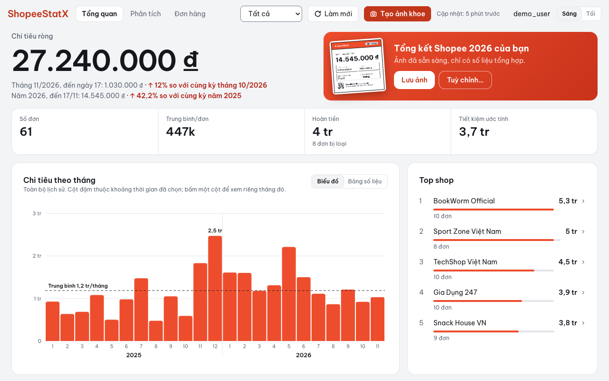
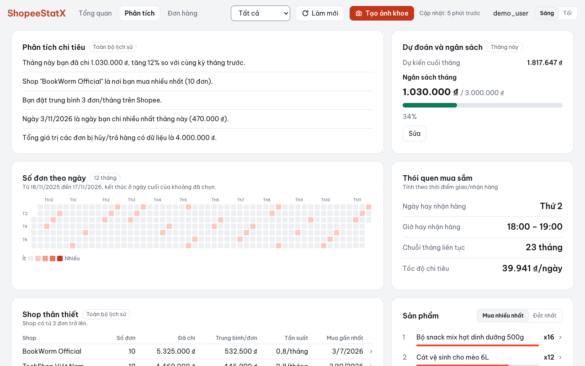
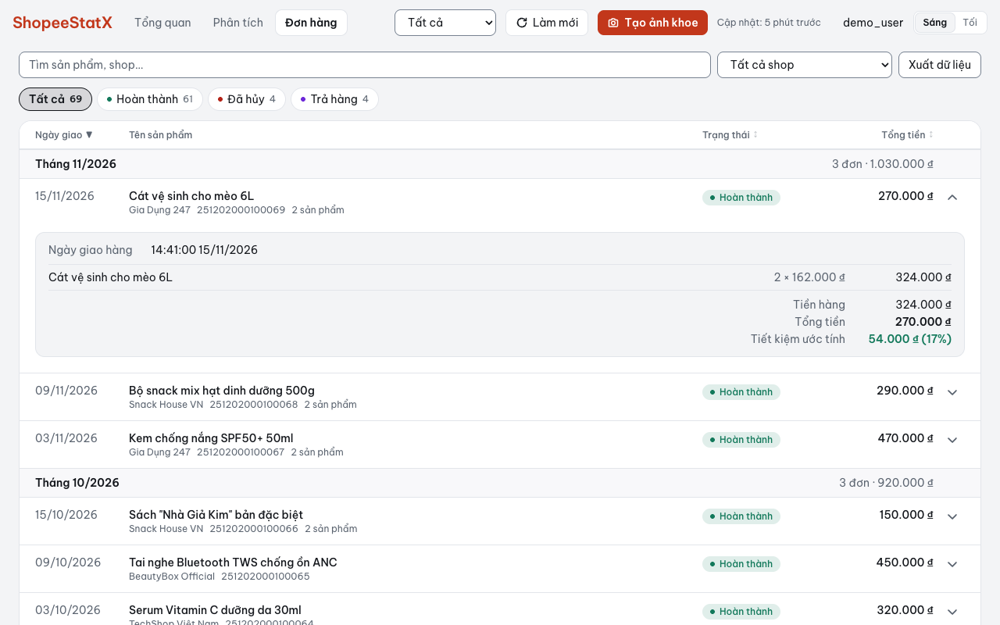
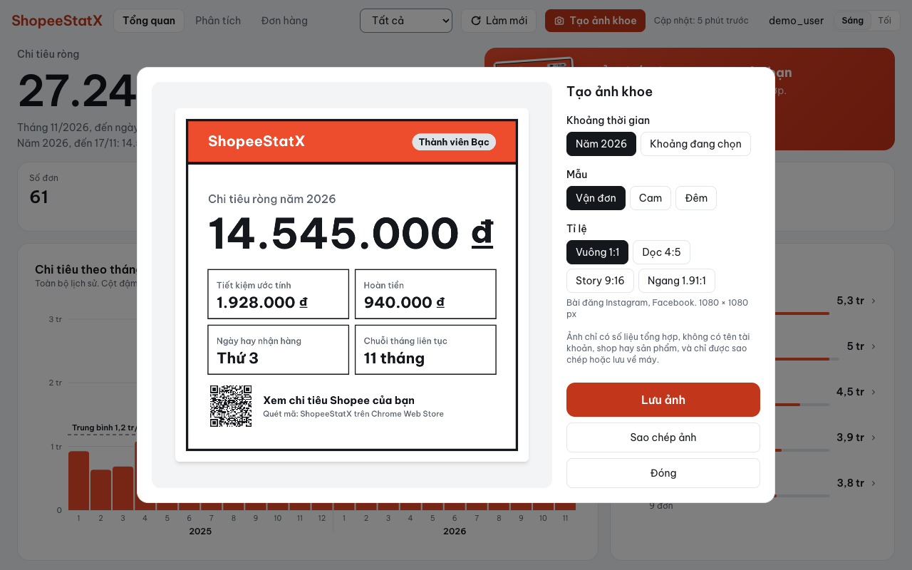
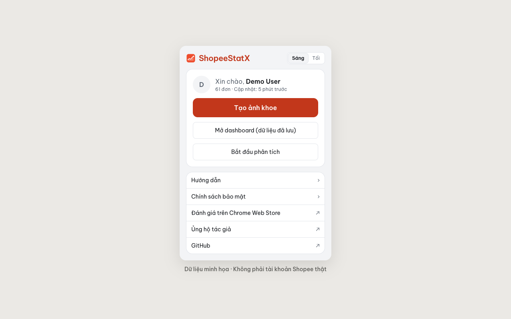

<div align="center">


# ShopeeStatX

**Understand what you spend on Shopee.**

A Chrome extension that turns your **Shopee Vietnam** order history into spending stats, shopping habits and a monthly budget — processed entirely in your browser.

[](https://chromewebstore.google.com/detail/shopeestatx/hhcfonmapcabjmaghpapehegbmhdceim)
[](https://github.com/ninhhaidang/shopeestatx/releases/latest)
[](https://github.com/ninhhaidang/shopeestatx/actions/workflows/ci.yml)
[](../../LICENSE)

[Install](https://chromewebstore.google.com/detail/shopeestatx/hhcfonmapcabjmaghpapehegbmhdceim) · [User guide](Guide.md) · [Tiếng Việt](../../README.md)

</div>

## Screenshots

| Overview | Analysis |
| --- | --- |
|  |  |
| **Orders** | **Share image** |
|  |  |
| **Popup** | |
|  | |

<sub>Screenshots show the Vietnamese interface with fictional demo data, not real purchases.</sub>

## Features

- **Overview** — net spend, order count, average order value; same-period month/year comparisons; refunds and estimated savings; monthly chart and top shops.
- **Analysis** — automatic insights, a monthly budget with warning threshold and month-end forecast, a daily heatmap, repeat shops and products.
- **Orders** — search by order ID, product or shop; filter by date and status; open each order's details.
- **Export** — Excel, CSV and Print/PDF of every filtered result; a share image with no account details.
- Light/Dark themes and a layout that adapts to narrow widths.

Cancelled, returned and unpaid orders are not counted as spending.

## Get started

1. [Install ShopeeStatX](https://chromewebstore.google.com/detail/shopeestatx/hhcfonmapcabjmaghpapehegbmhdceim) (or download the ZIP from [Releases](https://github.com/ninhhaidang/shopeestatx/releases/latest) and use **Load unpacked**).
2. Sign in to [shopee.vn](https://shopee.vn).
3. Click the extension icon → **Bắt đầu phân tích** (Start analysis).

See the [user guide](Guide.md) for details.

## Privacy

- Uses your existing Shopee session — no password to enter, no ShopeeStatX account.
- Data stays in `chrome.storage.local`; no server, no tracking, no telemetry.
- Uninstalling the extension deletes everything it stored.

Details are in the **Privacy policy** linked from the extension popup.

## Limitations

- Supports `https://shopee.vn` only, Chrome 116+.
- Depends on the data Shopee returns; changes on Shopee's side can break order collection.
- Date filters use the delivery/receipt date, not the order date.
- Savings and the month-end forecast are estimates.
- When opening a CSV in Excel, set the order ID column to Text to avoid rounding (XLSX is not affected).

## Development

Requires Node.js 24+ and Chrome 116+.

```bash
npm ci
npm run dev      # demo dashboard: http://localhost:5173/dashboard-app/dashboard.html
npm run build    # extension build in dist/ → chrome://extensions → Load unpacked
npm run verify   # typecheck, Knip, tests + coverage, build, injected-script check (same as CI)
```

Dev mode uses fake data and never calls the Shopee API. Stack: React 19, Tailwind CSS v4, Vite, ExcelJS; Chrome Manifest V3.

Contributor docs: [source architecture](../../src/README.md) · [feature inventory](../features.md) · [ADRs](../adr/) · [Shopee API constraints](../shopee-order-api.md) — **do not add new requests to Shopee**.

## Support

[Open an issue](https://github.com/ninhhaidang/shopeestatx/issues/new) with the extension version, Chrome version and steps to reproduce. Never post cookies, tokens or real order history.

Built by [Ninh Hải Đăng](https://github.com/ninhhaidang) · [Support the project](https://www.buymeacoffee.com/ninhhaidang)

ShopeeStatX is an independent project, not affiliated with Shopee. Released under the [MIT license](../../LICENSE).
